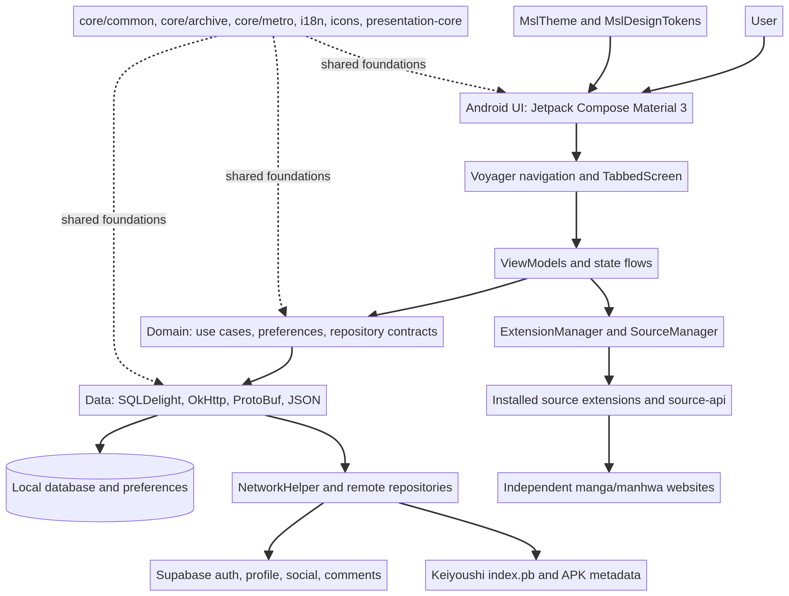
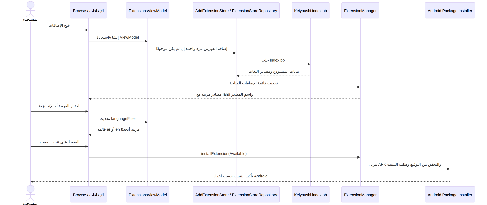
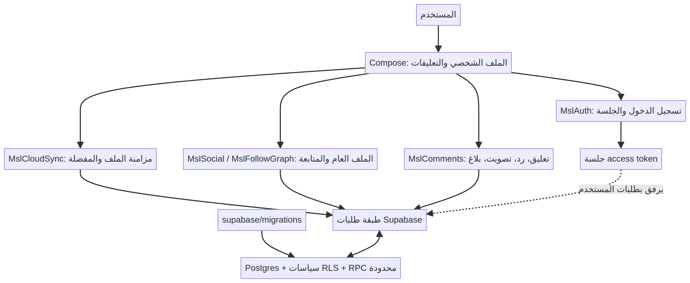

# دليل تطوير Manhwa Slime

**مرجع عملي للبنية، والواجهة، والمصادر، والحسابات، والأمن، والاختبار، والإصدار**  
آخر مراجعة: 11 أكتوبر 2026

> يصف هذا الدليل ما هو موجود في المستودع، ويقترح طريقًا تدريجيًا لتطويره. المخططات مفاهيمية للبنية الفعلية وليست بديلًا عن الكود أو مخطط قاعدة البيانات.

## 1. الرؤية والنتيجة المطلوبة

Manhwa Slime تطبيق Android لقراءة المانغا والمانهوا والروايات، مع مكتبة ومصادر قابلة للتوسعة، وصفحات حساب وتعليقات وتفاعل اجتماعي. الهدف من التطوير الحديث ليس إضافة مؤثرات بصرية فحسب؛ بل الجمع بين **واجهة متماسكة وسريعة**، و**حدود واضحة بين العرض والمنطق والبيانات**، و**تحديثات آمنة قابلة للاختبار**. الألوان البنفسجية/النيليّة والسماوية والذهبية جزء من هوية التطبيق الحالية، وينبغي أن تمر عبر رموز تصميم مركزية بدل تكرار قيم لونية ثابتة في كل شاشة.

## 2. نظرة معمارية

التطبيق مبني بـ Kotlin وAndroid وJetpack Compose، مع Material 3، وتدفقات حالة عبر ViewModels وKotlin Flow. يستخدم Voyager للتنقل، وMetro للحقن، وSQLDelight للتخزين المحلي، وOkHttp/Okio مع JSON وProtocol Buffers للشبكة. توجد وحدات مشتركة للبيانات والمنطق والتصميم والمصادر والأيقونات والتدويل؛ أما تجارب Manhwa Slime الخاصة فتوجد داخل التطبيق، ومنها طبقة الحسابات والتعليقات والمظهر.



| المنطقة | دورها | أمثلة من المشروع |
|---|---|---|
| التطبيق والعرض | الشاشات، التبويبات، عناصر Compose، حالات العرض | `app/src/main/java/eu/kanade/presentation`، `ui/browse`، `ui/profile` |
| المجال Domain | حالات الاستخدام، التفضيلات، النماذج، عقود المستودعات | `domain/`، `app/.../domain/` |
| البيانات Data | SQLDelight، HTTP، تحويل DTOs إلى نماذج المجال | `data/`، `app/.../data/` |
| المصادر | واجهة المصدر وإدارة المصادر المثبتة والمحلية | `source-api/`، `source-local/`، `ExtensionManager` و`SourceManager` |
| الأسس المشتركة | أدوات عامة، Compose، الأيقونات، النصوص، الأرشيف والحقن | `core/`، `presentation-core/`، `presentation-widget/`، `i18n/`، `icons/` |
| الخدمات الخارجية | خدمات يستهلكها التطبيق عبر طبقات محددة | Supabase، مستودع Keiyoushi، مواقع المصادر، Google ML Kit |

### قواعد اعتماد مهمة

1. الشاشة ترسم الحالة وتطلق حدثًا؛ لا تضع استعلام قاعدة البيانات أو طلب HTTP مباشرًا داخل Composable.
2. الـViewModel ينسق الحالة ويستدعي Interactor أو مديرًا قائمًا. يوضع منطق المجال الذي يمكن اختباره مستقلًا في Domain.
3. واجهة Domain تعتمد على عقد Repository، بينما Data تنفذ العقد وتملك SQL والشبكة والتحويل.
4. يستخدم `ExtensionManager` و`SourceManager` بدل بناء مسار تثبيت أو تحميل ثانٍ خاص بالكتالوج.
5. لا تُنسخ رموز الثيم إلى كل ميزة. تستخدم الشاشات `MaterialTheme.colorScheme` و`MslTheme` و`MslDesignTokens`.

## 3. الوحدات الحالية وحدودها

يضم Gradle حاليًا `:app`، و`:domain`، و`:data`، و`:core:common`، و`:core:archive`، و`:core:metro`، و`:source-api`، و`:source-local`، و`:presentation-core`، و`:presentation-widget`، و`:core-metadata`، و`:i18n`، ووحدات الأيقونات، و`:baseline-profile`، و`:telemetry`. هذه بنية عملية؛ لا يُنصح بإعادة كتابتها دفعة واحدة. الأفضل نقل ميزة مستقرة إلى وحدة feature فقط عندما تصبح حدودها واختباراتها واضحة، مع تجنب أن تعتمد وحدة منخفضة المستوى على `:app`.

المسار المعتاد للميزة:

```text
Compose Screen → ViewModel → Interactor/Domain → Repository interface
                                               ↑
                               Data implementation → SQLDelight/HTTP
```

## 4. المصادر والإضافات: فهرس Keiyoushi

الرابط الذي طلبته هو [فهرس Keiyoushi index.pb](https://github.com/keiyoushi/extensions/raw/repo/index.pb). تؤكد صفحة [مستودع Keiyoushi الرسمي](https://github.com/keiyoushi/extensions) أن هذا هو رابط الاستخدام لمستودع الإضافات. التطبيق يتضمن أصلًا قارئًا لـProtocol Buffers: `ExtensionStoreService` يقرأ الفهرس الثنائي إلى `NetworkExtensionStore`، ثم يحول حقل لغة كل مصدر إلى `Extension.Available.Source.lang`. لذلك فالأفضل جلب الفهرس الحي، لا حفظ قائمة أسماء محلية ستتقادم.

### ما أضيف في تبويب «تصفح ← الإضافات»

- يُسجل رابط Keiyoushi تلقائيًا عند أول تحميل لقائمة الإضافات، مرة واحدة فقط. إذا أزاله المستخدم لاحقًا فلن تعيده الشاشة تلقائيًا؛ ويمكنه إدارته من شاشة المستودعات الموجودة.
- أضيف محدد **الكل / المصادر العربية / المصادر الإنجليزية**. المطابقة تعتمد على رمز اللغة الأساسي (`ar` أو `en`) وتتعامل مع صيغ المنطقة مثل `en-US` و`ar-SA`.
- تُعرض عناصر الفهرس وفق أسماء المصادر وبالترتيب الأبجدي الذي تستخدمه قائمة الإضافات الحالية. تبقى ألوان الثيم الأصلية مطبقة من MaterialTheme، لا من ألوان ثابتة من الصورة المرجعية.
- يؤدي الضغط على عنصر متاح إلى مسار التثبيت الموجود أصلًا عبر `ExtensionManager` وAndroid Package Installer. لا يحدث تثبيت صامت: يظل المستخدم هو من يبدأ التثبيت ويوافق على طلب Android عند الحاجة.
- أضيفت اختبارات لوظائف المطابقة اللغوية في `app/src/test/.../ExtensionLanguageFilterTest.kt`.



### الملفات التي تبدأ منها عند صيانة هذه الميزة

توجد الملفات الأربعة الأولى داخل `app/src/main/java`، والأخيرة داخل `data/src/main/java`:

- `ExtensionsScreen.kt` — عرض القائمة وفلاتر اللغة.
- `ExtensionsTab.kt` و`ExtensionsViewModel.kt` — ربط التبويب والحالة والتثبيت.
- `GetExtensionsByType.kt` — تجميع اللغات واحترام الإعدادات مع تضمين `ar` و`en`.
- `SourcePreferences.kt` — حالة تسجيل المستودع الافتراضي مرة واحدة.
- `ExtensionStoreService.kt` و`NetworkExtensionStore.kt` — قراءة Protocol Buffers والتحويل.

## 5. نظام التصميم والحركة

### الهوية

اجعل الألوان ذات المعنى أسماءً مركزية: خلفية داكنة، سطح، سطح مرتفع، بنفسجي رئيسي، سماوي تفاعلي، ذهبي للترقية، ونصوص واضحة. لا تستخدم التوهج حول كل عنصر؛ يوضع على نقاط التركيز مثل العنصر المحدد أو CTA أو حالة VIP. يجب أن يبقى التباين جيدًا في الوضعين الداكن والفاتح، وأن تُختبر ألوان Android التقليدية وشريط النظام إلى جانب Compose.

توجد الرموز المشتركة في `app/src/main/java/eu/kanade/tachiyomi/mslime/MslDesignTokens.kt` وطبقة المظهر في `MslTheme.kt`، ويطبق `TachiyomiTheme` لوحة Material على واجهات Compose. أي لون جديد يضاف إلى هذه الطبقات ثم يعاد استخدامه بدل `Color(...)` متكرر.

### الحركة المناسبة

- اجعل الحركة قصيرة وهادئة: انتقال لون/حجم للبطاقات، ظهور متدرج خفيف، وانتقال صفحة صغير.
- احترم إعداد تقليل الحركة في Android؛ أوقف النبض والحركة غير الضرورية عند تفعيله.
- لا تربط الحركة بتغييرات حالة عالية التردد أو عمليات IO، ولا تنشئ `rememberInfiniteTransition` لكل عنصر في قائمة طويلة.
- استخدم `animateItem()` للقوائم عند الفرز، وأبق المحتوى ثابتًا عندما لا تكون الحركة ذات معنى.
- راجع إمكانية الوصول: حالات التركيز، حجم اللمس، أوصاف الصور، تباين النص، واتجاه RTL.

### بنية شاشة موصى بها

لكل شاشة: عنوان واضح، إجراء رئيسي واحد، حالات تحميل/فراغ/خطأ/نجاح، ثم قائمة بكسل/شبكة قابلة للتمرير. تجنب قوائم Compose المتداخلة غير المحدودة. عند تحميل صور الملف الشخصي أو سجل القراءة استخدم `produceState` أو تدفقًا مناسبًا، نفّذ فك الصور/قراءة السجل خارج Main Thread، وصغّر الصور وخزّن النتيجة إذا تكرر استخدامها.

## 6. الحساب والمزامنة والتفاعل

الحساب والمزامنة والتعليقات الاجتماعية موجودة ضمن `MslAuth.kt` و`MslCloudSync.kt` و`MslSocial.kt` و`MslComments.kt`. مخطط Supabase وإجراءاته محفوظة تحت `supabase/migrations/`. يجب أن تكون كل قراءة/كتابة لحساب مستخدم مقيدة بـRLS أو RPC محدود، وألا يُعتمد على إخفاء زر في التطبيق كحاجز صلاحيات. أي إضافة جدول تتطلب migration قابلة للتكرار، سياسة قراءة/كتابة واضحة، وتحققًا من هوية صاحب السجل.



عند تعديل واجهة الشبكة، ميّز بوضوح بين خطأ اتصال مؤقت، ورفض صلاحية، وغياب جلسة. لا تعرض access token أو بيانات خاصة في السجلات. استخدم pagination للقوائم الاجتماعية مستقبلًا بدل تنزيل كامل القائمة عند نموها، مع إلغاء الطلبات القديمة عند تغيير الشاشة أو البحث.

## 7. الأمان والخصوصية والامتثال

1. لا تضع service-role keys أو مفاتيح توقيع APK أو كلمات مرور داخل Git أو التطبيق. استخدم GitHub Actions Secrets أو مدير أسرار مناسبًا، واجعل أي مفتاح عميل عامًا محدود الامتياز ومقيدًا بسياسات RLS.
2. امنع SQL الديناميكي غير المقيد، والتحقق من ملكية التعليقات والعلاقات داخل الخادم.
3. المستودعات والإضافات البرمجية مصادر طرف ثالث. اعرض بيانات الناشر/التوقيع، واستخدم آلية الثقة والتثبيت الحالية، ولا تتجاوز موافقة Android.
4. لا تسجل نصوص القراءة الخاصة أو البريد أو رموز الجلسة. قلل القياسات عن الحد اللازم، واجعل التحليلات اختيارية إذا لم تكن لازمة للتشغيل.
5. راجع تراخيص المحتوى وسياسات المواقع. التطبيق يوفّر قارئًا ومصادر؛ لا ينبغي أن يزيل حماية مصدر أو يتجاوز قيود وصوله.
6. أدخل migration جديدة تحت `supabase/migrations/` واختبر RLS في مشروع اختبار قبل تعميم أي تغيير إنتاجي.

## 8. الأداء والموثوقية

مناطق الانتباه: قارئ الصفحات، تنزيلات متعددة، غلاف الملف الشخصي، مكتبة كبيرة، وتحديث فهرس الإضافات. استخدم `Dispatchers.IO` للشبكة والملفات، و`Dispatchers.Default` للمعالجة الحسابية، واحتفظ بتحديث واجهة المستخدم في Main. لا تجعل كل حركة سحب تعيد طلب الملف السحابي أو تفك كل الصور من جديد.

**مؤشرات جودة مقترحة:** زمن فتح المكتبة، زمن أول إطار، عدد ANR، استخدام الذاكرة على جهاز منخفض المواصفات، معدل فشل تنزيل الإضافة، نجاح تسجيل الدخول والمزامنة، ومدة استجابة البحث. ضع حدودًا وقياسات قبل إضافة تحسينات عمياء.

## 9. الاختبارات والتحقق

طبقات الاختبار المقترحة:

- **Unit tests:** محولات النماذج، فلاتر اللغات، منطق الترتيب، UseCases، وسياسات الصلاحية.
- **Repository tests:** قاعدة بيانات مؤقتة وHTTP mock/fixtures؛ لا تعتمد الاختبارات على مواقع المصادر الحية.
- **Compose UI tests:** الفلاتر الثلاثة، الحالة الفارغة، النقر على التثبيت، RTL، والوضع الفاتح/الداكن.
- **Integration tests:** تسجيل مستودع اختبار، تحديث قائمته، تثبيت extension تجريبي، واستعادة مستودعات النسخة الاحتياطية.
- **Regression tests:** الملف الشخصي أثناء السحب، شاشة التعليقات والردود، معالجة أخطاء ML Kit، وAndroid versions مختلفة.

أوامر العمل المحلية:

```bash
export ANDROID_HOME="$HOME/Android/Sdk"
export ANDROID_SDK_ROOT="$HOME/Android/Sdk"
./gradlew :app:assembleDebug :app:testDebugUnitTest
./gradlew :app:spotlessCheck
```

يُفضّل إضافة خطوة `:app:testDebugUnitTest` وفحص Spotless إلى CI؛ إعداد GitHub Actions الحالي يبني Debug وRelease ويرفع APKين، لكنه لا يشغل اختبارات الوحدة حاليًا.

## 10. البناء والإصدار عبر GitHub Actions

تعريف البناء في `.github/workflows/msp.yml`. يعمل عند push/PR للفروع المحددة فيه، كما يدعم `workflow_dispatch` للبناء اليدوي على فرع ميزة. يثبت CI Java وAndroid SDK، ثم يشغل `assembleDebug assembleRelease`، ويرفع `app-arm64-v8a-debug.apk` و`app-arm64-v8a-release.apk` كـArtifacts.

قبل نشر إصدار عام:

- ثبّت سياسة versionCode/versionName وملاحظات الإصدار.
- أدِر مفتاح التوقيع في مخزن أسرار محمي، وتحقق من أن نسخة Release موقعة بالمفتاح المقصود لا بمفتاح تطوير.
- أضف اختبارات الوحدة وفحوص التنسيق وفحص dependency/security إلى CI.
- احتفظ ببصمات artifacts وسجل commit الذي أنتجها.
- لا تضع APK الناتج داخل Git؛ استخدم GitHub Artifacts أو Releases وفق سياسة المشروع.

## 11. خارطة تطوير تدريجية

| المرحلة | المجال | العمل المقترح | معيار الإكمال |
|---|---|---|---|
| 1 — تثبيت الأساس | المصادر | حالات تحميل/انقطاع واضحة، تحديث يدوي، اختبار تثبيت فعلي، بيانات المستودع | تظهر العربية والإنجليزية، الفراغ والخطأ مفهوم، والتثبيت يمر عبر Android بأمان |
| 2 — تجربة الاستخدام | الملف الشخصي والإعدادات | RTL شامل، تقليل الحركة، حالات الشبكة، صور محسّنة، سلوك تمرير ثابت | لا تجمّد مع سجل كبير؛ ونتائج اختبارات Compose الأساسية خضراء |
| 3 — جودة البيانات | الحساب والتعليقات | pagination، مؤشرات optimistic مع rollback، RLS لكل endpoint، rate limiting | لا يستطيع مستخدم قراءة/تعديل بيانات غيره، وفشل الشبكة قابل للاستعادة |
| 4 — حدود الوحدات | هندسة المشروع | فصل Browse/Profile تدريجيًا إلى وحدات feature عند استقرار العقود | لا اعتماد عكسي على `:app`، ومجموعة اختبارات مستقلة لكل ميزة |
| 5 — الإصدار | CI/Observability | اختبار+تنسيق+فحص dependency، توقيع أسرار، قياس ANR والأداء | artifact قابل لإعادة الإنتاج ومطابق للـcommit وموقّع حسب سياسة النشر |

لا تبدأ بتقسيم المشروع إلى عشرات الوحدات أو استبدال قاعدة البيانات/التنقل كاملًا. ابدأ بتحسين قابلية الاختبار ومقاييس الأداء، ثم انقل الحدود المستقرة واحدةً واحدة.

## 12. قائمة مراجعة لأي Pull Request

- هل يتبع التغيير المسار Compose → ViewModel → Domain → Repository؟
- هل توجد حالات loading/empty/error وترجمة مناسبة للنصوص؟
- هل كل الشبكة والملفات خارج Main Thread؟ وهل يوجد إلغاء/cancellation صحيح؟
- هل التغييرات متوافقة مع الثيم المركزي وRTL وتقليل الحركة؟
- هل صلاحيات Supabase وRLS، أو توقيع الإضافات، محفوظة؟
- هل أضيف اختبار لوظيفة مهمة؟ وهل `git diff --check` وSpotless والبناء ناجحة؟
- هل migration قابلة للتطبيق والتراجع/التصحيح؟ وهل لم يُسجل أي سر؟
- هل توضح ملاحظات التغيير أثره على المستخدم وطريقة استرجاع السلوك عند الفشل؟

## 13. مصادر مرجعية داخلية وخارجية

- [مستودع Keiyoushi وفهرس الإضافات](https://github.com/keiyoushi/extensions)
- [رابط index.pb المستخدم داخل التطبيق](https://github.com/keiyoushi/extensions/raw/repo/index.pb)
- [شفرة بناء إضافات Keiyoushi](https://github.com/keiyoushi/extensions-source)
- مسارات التطبيق الأساسية موضحة في جدول الوحدات وفي قسم المصادر أعلاه.

## ملحق: تدفق إضافة مصدر جديد

1. أضف المصدر إلى مستودع الإضافات المعتمد، مع لغة صحيحة واسم وأيقونة وروابط إصدار.
2. تأكد من توقيع APK بالمفتاح الموثوق للمستودع وإمكانية التحديث مع الحفاظ على package name.
3. حدّث فهرس `index.pb` في المستودع؛ لا تضف قائمة محلية متوازية إلى التطبيق.
4. من Manhwa Slime افتح **تصفح ← الإضافات**، اختر اللغة المطلوبة، ثم اضغط المصدر. وافق على تثبيت Android عند ظهوره.
5. بعد التثبيت تحقق من ظهور المصدر في **تصفح ← المصادر**، ثم اختبر البحث وتصفح العناوين دون جلسة أو بصلاحيات أكثر من اللازم.
